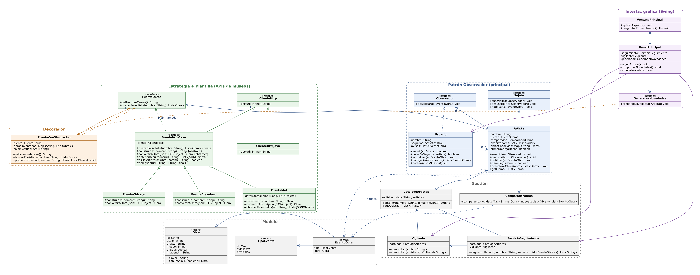

# ArtAlert

Aplicación de escritorio en Java (Swing) que avisa a cada usuario de lo que pasa con los artistas que sigue en varios museos: **obras nuevas** en la colección, obras que **salen a sala** y obras que **se retiran**. Cada usuario elige libremente qué artistas sigue y en qué museos: ninguno, uno o todos.

Práctica 7 de Diseño y Análisis de Patrones (ULL).

## Museos

APIs públicas y sin clave:

| Museo | Clase | Cómo se sabe si está en sala |
|---|---|---|
| Art Institute of Chicago | `FuenteChicago` | campo `is_on_view` |
| Cleveland Museum of Art | `FuenteCleveland` | `current_location` tiene valor |
| The Metropolitan Museum of Art | `FuenteMet` | búsqueda con el filtro `isOnView=true` |

## Patrones de diseño

| Patrón | Dónde | Qué aporta |
|---|---|---|
| **Observador** (principal) | `Artista` es el sujeto y `Usuario` el observador | Cada usuario recibe solo los avisos de los artistas que sigue, sin que `Artista` sepa nada de `Usuario`. "Monet en Chicago" y "Monet en The Met" son sujetos distintos. |
| **Estrategia** | `FuenteObras`, con una implementación por museo | El usuario elige los museos y cada uno se consulta a su manera. El resto del programa no sabe de qué museo se trata. |
| **Plantilla** | `FuenteHttpBase.buscarPorArtista()` (`final`) | Fija los pasos (URL → petición → JSON → `Obra` → filtro por artista). Cada museo solo implementa lo que le diferencia. The Met sobrescribe el gancho `obtenerResultados()` porque necesita varias llamadas. |
| **Decorador** | `FuenteConSimulacion` | Envuelve cualquier museo y permite simular novedades para la demostración (en un museo real los cambios tardan semanas), sin modificar las fuentes reales. |

No se usan **Estado** ni **Abstract Factory**: una obra solo tiene dos estados (en sala o no) y no hay familias de objetos que crear juntos, así que solo añadirían complejidad.

### Cómo funciona el Observador

1. El usuario sigue a un artista en uno o varios museos (`ServicioSeguimiento`). El catálogo devuelve siempre el mismo objeto `Artista` para cada artista y museo, así que todos sus seguidores comparten sujeto.
2. La primera carga de obras no avisa de nada: lo que ya existía no es una novedad.
3. Al comprobar novedades, el `Vigilante` pide al museo las obras **solo de los artistas que tienen seguidores**.
4. El `Artista` compara lo que conocía con lo nuevo (`ComparadorObras`) y llama a `notificar()`, que avisa a cada `Usuario` suscrito con un `EventoObra` (NUEVA, EXPUESTA o RETIRADA).
5. `Artista` y `Usuario` están sincronizados, porque las comprobaciones se hacen en segundo plano mientras la ventana lee los avisos.

## Principios SOLID

| Principio | Cómo se aplica |
|---|---|
| **S**: responsabilidad única | Cada clase hace una cosa: `Artista` gestiona sus observadores, `ComparadorObras` decide qué ha cambiado, `Vigilante` consulta los museos, `ServicioSeguimiento` aplica la regla de seguir, `PanelPrincipal` solo muestra y cada lista tiene su propio renderizador. `Main` solo crea y conecta objetos. |
| **O**: abierto/cerrado | Añadir The Met solo ha necesitado una clase nueva y una línea en `Main`. Las novedades simuladas se añaden con un decorador, sin tocar las fuentes. |
| **L**: sustitución de Liskov | Toda `FuenteObras` cumple el mismo contrato: nunca devuelve `null` y, si el museo falla, lanza `FuenteNoDisponibleException`. El decorador se comporta igual que la fuente que envuelve mientras no se simula nada. |
| **I**: segregación de interfaces | Interfaces pequeñas: `Observador` (1 método), `Sujeto` (3), `FuenteObras` (2), `ClienteHttp` (1), `GeneradorNovedades` (1). La interfaz gráfica no conoce `FuenteConSimulacion`, solo `GeneradorNovedades`. |
| **D**: inversión de dependencias | Las clases reciben sus dependencias por constructor y dependen de interfaces (`Observador`, `FuenteObras`, `ClienteHttp`). Gracias a eso las pruebas usan museos y clientes HTTP falsos, sin internet. |

## Diagrama UML



## Estructura

```
src/main/java/artalert/
├── modelo/       Obra, EventoObra, TipoEvento
├── observador/   Sujeto, Observador
├── fuentes/      FuenteObras, FuenteHttpBase, ClienteHttp, ClienteHttpJava,
│                 FuenteNoDisponibleException, FuenteChicago, FuenteCleveland,
│                 FuenteMet, FuenteConSimulacion
├── artistas/     Artista, ComparadorObras, CatalogoArtistas, Vigilante
├── usuarios/     Usuario, ServicioSeguimiento
├── util/         Textos
├── gui/          VentanaPrincipal, PanelPrincipal, DialogoNombre, DialogoSeguir,
│                 TarjetaObra, RenderArtista, RenderAviso, Estilo,
│                 CargadorImagenes, DisposicionFluida, GeneradorNovedades
└── app/          Main
```

## Reparto del trabajo

Se ha trabajado como dos personas sobre el mismo repositorio. Cada una tiene su rama (`persona-a`, `persona-b`), integra su trabajo en `develop` mediante Pull Requests y `master` solo recibe el resultado final.

| PR | Persona | Contenido |
|---|---|---|
| #1 | A | `Artista` (sujeto), `ComparadorObras`, `CatalogoArtistas`, `Vigilante`, `FuenteChicago` |
| #2 | B | `Usuario` (observador), `FuenteCleveland` |
| #3 | A | Decorador `FuenteConSimulacion` e imagen en `Obra` |
| #4 | B | Interfaz gráfica e imágenes de las obras |
| #5 | A | Revisión SOLID y del Observador (código compartido, avisos sin duplicar, sincronización) |
| #6 | B | Revisión SOLID (`ServicioSeguimiento`, renderizadores) |
| #7 | A | `FuenteMet` |
| #8 | B | The Met en la aplicación |
| #9 | A | Arreglo de The Met (menos peticiones, evita el error 403) |

## Cómo ejecutar

1. Abrir la carpeta en IntelliJ IDEA (detecta el `pom.xml`) y esperar a que Maven descargue las dependencias.
2. Ejecutar `artalert.app.Main`.
3. Escribir un nombre, pulsar **+ Seguir artista** y elegir artista y museos.
4. Para ver el Observador en acción: seleccionar un artista, pulsar **✦ Simular novedad** y después **↻ Comprobar novedades**.

Consejo: los artistas de dominio público (Monet, Van Gogh, Renoir…) muestran todas sus imágenes. Las obras con derechos de autor salen sin foto porque los museos no la publican.

Las pruebas están en `src/test/java` (clic derecho en `test` → *Run 'All Tests'*).